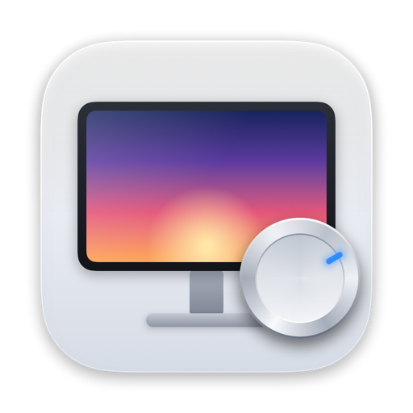

# Knob

Monitor settings from your menu bar. A macOS (Apple Silicon) app that controls an external monitor's settings over DDC/CI,
so you don't have to reach for the buttons under the screen. Built first for the **AOC 24G1WG4**;
other DDC monitors get the standard controls they advertise.

**Controls:** brightness, contrast, picture mode, color temperature, red/green/blue gain (in User
color mode), input source. The panel reads fresh values from the monitor every time it opens, so
changes made with the monitor's own buttons show up too.

**Not possible over DDC on the 24G1WG4:** Game Mode, Overdrive, Shadow Control, Low Blue Light,
Game Color, crosshair. The monitor doesn't expose them to the computer.

## Download and install

1. Download `Knob-<version>.dmg`, open it, and drag **Knob** onto **Applications**.
2. Open Knob. The first time, macOS blocks it: Knob isn't notarized by Apple (that needs a paid
   Apple Developer account), so Gatekeeper rejects it. Go to **System Settings → Privacy &
   Security**, find "Knob was blocked", click **Open Anyway**, and confirm. On recent macOS,
   right-click → Open no longer skips this. (Terminal alternative:
   `xattr -dr com.apple.quarantine /Applications/Knob.app`.)
3. Knob lives in the menu bar (monitor icon). If it says the monitor isn't answering, turn on
   DDC/CI in the monitor's own menu.

Requires an Apple Silicon Mac and macOS 14 or later (developed and tested on macOS 27).

## Build and install

Needs only the Xcode Command Line Tools (`xcode-select --install`), no Xcode.

```bash
./build.sh test      # parser tests
./build.sh install   # build, install to ~/Applications/Knob.app and launch
./build.sh dmg       # build build/Knob-<version>.dmg for distribution
```

SwiftPM isn't used because the Command Line Tools' manifest library is broken on this machine,
and SwiftUI's `@State` macro plugin is missing from it, so view state uses `ObservableObject`.

`Knob --snapshot out.png` renders the panel with live monitor values to an image and exits.
`Knob --bench` times picture-mode and color changes through the real model, restores them, and exits.

## Timing

Measured on the AOC 24G1WG4: a raw I2C write takes ~5 ms and a read ~7 ms; one DDC read round
trip is ~54 ms (single send, 40 ms DDC/CI reply wait). A picture-mode or color change completes in
~0.45 s: write, poll until the monitor reports the new value (~0.1 s for a mode change), then
re-read only the settings that change can affect (brightness and contrast first). Input and
refresh rate are read at launch and on Refresh, not on every panel open.

Launch reaches a ready panel in ~0.5 s (was ~1.4 s): the monitor's capabilities list (14 round
trips, ~0.8 s) is cached in Knob's preferences, keyed by the display's EDID UUID (one entry per
monitor model). Only complete lists are cached, a cached code the monitor reports unsupported
drops the entry, and the Refresh button always re-reads the list, so a stale entry is one click
from fixed. Clear the cache with `defaults delete dev.yusifabasov.knob`.
`Knob --bench --launch-only [--rescan]` times launch (and a Refresh) only.

## Requirements and limits

- Apple Silicon Mac; DDC goes through the private `IOAVService` API (same as MonitorControl / m1ddc),
  so this can't ship on the App Store and a macOS update could break it.
- **DDC/CI must be on** in the monitor's menu (AOC: *Extra → DDC/CI → Yes*).
- Some ports don't carry DDC (e.g. the HDMI port on M1 Mac mini).
- Switching input moves the monitor away from this Mac, after which the app can't reach it;
  switch back with the monitor's buttons.
- Another DDC app polling the monitor at the same time (MonitorControl, BetterDisplay, Lunar...)
  shares the same I2C bus. Knob verifies every change and re-sends it, so changes still land,
  but about 1 in 8 reads can fail while the other app is polling (retries use random backoff),
  which can leave a value briefly stale.
- The power-off command (VCP `0xD6`) is deliberately not exposed: monitors turned off over DDC often
  can't be turned back on over DDC.

## Layout

| Path | What |
|---|---|
| `Sources/CDDC/` | C wrapper over the IOAVService I2C calls: read/write VCP, read capabilities |
| `Sources/MonitorCore/` | Capabilities-string parser and monitor profiles (value labels per brand) |
| `Sources/App/` | SwiftUI menu bar app: `MonitorModel` (state, coalesced writes), `PanelView`, components |
| `Tests/` | Plain test runner for MonitorCore |
| `Tools/Icon.swift` | Draws the app icon in SwiftUI; `build.sh` renders it into `AppIcon.icns` (concept set by `ICON_CONCEPT`) |

## Calibrating labels

Picture-mode (`0xDC`) and color-preset (`0x14`) numbers are brand-specific. The labels in
`MonitorProfile.aoc24G1` are still best guesses: confirm them by selecting each option with the
monitor's buttons and reading the value back. To add another monitor, do the same and add a profile keyed by its
capabilities `model(...)` string.
